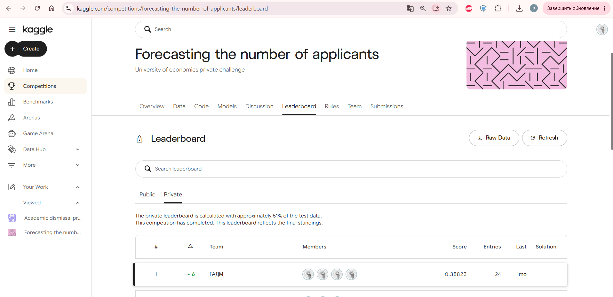
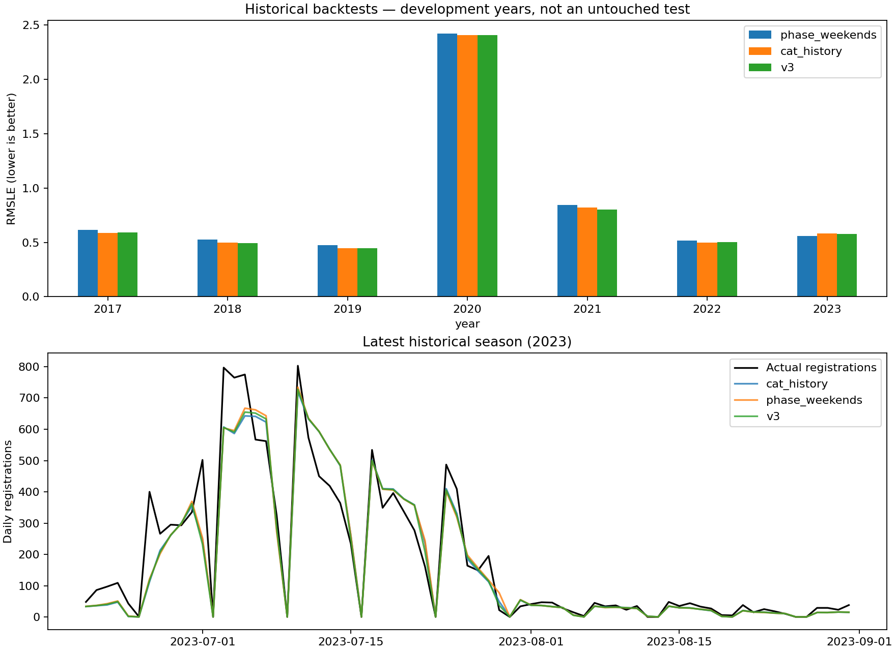

# Forecasting the Number of Applicants

**Прогнозирование ежедневного числа регистраций в приёмную кампанию университета.**

Командный проект закрытого университетского [соревнования на Kaggle](https://www.kaggle.com/competitions/forecasting-the-number-of-applicants). История регистраций за 2014–2023 годы используется для прогноза на 20 июня — 31 августа 2024 года: 73 календарных дня.

**Командное достижение:** 1-е место в итоговом Private Leaderboard, команда **«ГАДМ»**, 4 участника, **RMSLE 0.38823**, 24 отправленных решения. Сведения предоставлены участницей; место, состав по числу участников, score и число отправок подтверждаются предоставленным скриншотом итогового лидерборда. Скриншот итогового лидерборда приведён ниже.

Установить, какая из сохранённых версий соответствует финальному результату, невозможно. Значение 0.38823 не является локально воспроизведённой метрикой и не приписывается конкретной модели. Индивидуальные роли участников не документированы; проект представлен как командная работа.

> Репозиторий приватный. Исходные данные и файлы предсказаний не включены. Без локального архива доступны только тесты на синтетических данных.

## Результаты

### Итоговый Private Leaderboard



**Командный результат:** 1-е место, RMSLE **0.38823**, 4 участника, 24 отправки. Соответствие результата конкретной версии решения не установлено.

### Историческая валидация



Локальные backtests на исторических сезонах; **не результат Private Leaderboard**. Эти годы использовались при разработке моделей. Верхняя панель сравнивает RMSLE по годам, нижняя — фактические регистрации и прогнозы за 2023 год. Расширенная версия не превосходит основу на каждом году; 2020 показан как отдельный стресс-сезон.

## Задача и данные

Практический сценарий — оценка ежедневной нагрузки на приёмную кампанию. Это возможное применение прогноза, а не заявленный результат внедрения.

Код агрегирует **число строк регистрации по дате `reg_ts`**, а не число уникальных `abitur_kod`. Соответствие этой агрегации официальному определению цели требует сверки с описанием закрытого соревнования. Выбор сезона 20 июня — 31 августа следует из предоставленного кода; даты без записей заполняются нулями. Ноль здесь означает отсутствие записей в выгрузке, что предполагает полноту выгрузки.

В архиве находятся таблицы зарегистрированных, включённых в конкурсные списки и статусов заявлений. Модели используют только дневные количества из первой таблицы. Идентификаторы, типы документов, статусы и даты отказа не используются как признаки. Подробности: [контракт данных](docs/data.md).

## Две сохранённые версии

| Файл | Происхождение | Содержание |
|---|---|---|
| `solutions/forecast_clean.py` | `forecast_clean/solution.py` | Семейство моделей; стандартный режим `phase_weekends` |
| `solutions/extended_v3.py` | `presentation_selection/01_v3/solution.py` | Общие модели, CatBoost-коррекция, Ridge для суббот и приближённая hurdle-модель |

Оба исходных файла сохранены побайтово. Названия отражают содержимое и исходные каталоги, а не доказанную хронологию отправок. В первом файле уже есть опциональный `cat_history`; расширение v3 добавляет дальнейшую комбинацию и специальные модели суббот. Исходные комментарии о public score, «champion» и «verified» сохранены для целостности, но не служат подтверждением результатов. Актуальные ограничения изложены здесь и в [аудите](docs/audit.md).

### Признаки и модели

- Календарь: день от начала сезона (`doy`, отсчёт с нуля), день недели, суббота/воскресенье, фаза с `doy >= 36` (26 июля). Отдельный режим `calendar` добавляет номер буднего дня, номер субботы и флаги первого буднего дня/понедельника.
- `HistGradientBoostingRegressor` обучается на `log1p(y)`, с экспоненциальным затуханием веса старых лет. Есть вариант с повышенным весом недавних суббот и гибрид сезонного профиля с эффектами дней недели.
- Базовый ансамбль объединяет три модели с весами 0.4/0.4/0.2 в логарифмическом пространстве. Далее усредняются варианты затухания и шесть конфигураций бустинга, сглаживаются прогнозы будней, добавляется поправка начала сезона по недавней истории.
- `phase_weekends`: кубические сплайны с 8/14/22 узлами и Ridge, раздельные фазы кампании, отдельные исторические профили суббот. Для воскресений базовые модели задают константу 0.3. Это фиксированное решение из кода, а не доказанное универсальное правило.
- `cat_history`: CatBoost прогнозирует остаток относительно исторического профиля в `log1p`-шкале; четыре сглаженных исторических признака рассчитываются строго по предыдущим сезонам. Смесь: 75% `phase_weekends`, 25% скорректированный CatBoost-профиль в логарифмическом пространстве.
- `v3`: среднее `phase_weekends` и `cat_history` в `log1p` (до субботних поправок эквивалентно 87.5%/12.5%). Для суббот начиная с `doy >= 7` добавляет 30% сплайнового Ridge; первую субботу заменяет приближённым hurdle-прогнозом. Последний сочетает вероятность ненулевого дня, Poisson-регрессию на положительных наблюдениях и отрицательно-биномиальную аппроксимацию ожидаемого `log1p(y)`. Это не точное MLE усечённой NB-модели.

2020 год исключён из большинства исторических профилей или имеет нулевой вес в обучении. В некоторых бустингах строки с нулевым весом остаются на входе, поэтому это не буквальное удаление года из всех внутренних преобразований. Прогнозы неотрицательны; CSV для отправки округляет их до двух знаков.

## Валидация и метрика

Для каждого проверяемого года обучение использует только более ранние годы. Случайное перемешивание дней не применяется.

- `forecast_clean`: 2018, 2019, 2021, 2022, 2023; отдельно 2020.
- `extended_v3`: дополнительно 2017; отдельно 2020.
- Для сравнения версий нужны одинаковые годы. Среднее по годам — макросреднее RMSLE, не RMSLE объединённого массива.
- 2020 рассматривается как стресс-сезон, но эта трактовка принята в ходе разработки и не делает оценку независимой.

$$\mathrm{RMSLE}=\sqrt{\frac{1}{n}\sum_{i=1}^{n}(\log(1+\hat y_i)-\log(1+y_i))^2}.$$

Меньше — лучше. Локальная оценка использует неокруглённые прогнозы. Исторические годы использовались при разработке: это ретроспективные backtests, а не нетронутая финальная выборка. Многократный выбор гиперпараметров и 24 отправки могли привести к переадаптации; её величина неизвестна. Истинные цели 2024 года отсутствуют, поэтому воспроизвести private score локально нельзя.

## Запуск

Проверено на Windows, CPython **3.11.4**. Исходное окружение соревнования неизвестно; `requirements.txt` фиксирует окружение текущей проверки.

```bash
python -m venv .venv
```

Активация в PowerShell: `.\.venv\Scripts\Activate.ps1`; в Linux/macOS: `source .venv/bin/activate` (эти ОС отдельно не проверялись).

```bash
python -m pip install -r requirements.txt
python -m unittest discover -s tests -v
```

При наличии законного доступа к исходному архиву, из корня репозитория:

```bash
python scripts/prepare_data.py --archive "/path/to/abitur_stage1.zip"
python scripts/run.py --version clean
python scripts/run.py --version v3
python scripts/plot_validation.py --results artifacts/v3
```

В Windows замените путь на свой, например `"C:\path\abitur_stage1.zip"`. Подготовка читает только `reg_ts` из таблицы регистраций и создаёт `data/processed/daily_registered.csv`. Обёртка проверяет точное покрытие всех 10 сезонов, уникальность дат и допустимость значений перед запуском неизменённого решения.

Для прогноза без backtests добавьте `--no-validate`. Каталог результатов меняется через `--out-dir`. Чтобы запустить другие сохранённые режимы первого файла напрямую:

```bash
python solutions/forecast_clean.py --daily data/processed/daily_registered.csv --model cat_history --out-dir artifacts/cat_history
```

Режимы `baseline`, `calendar`, `spline`, `phase`, `soft_transition` также сохранены. Их наличие не означает, что каждый режим отдельно прошёл полный аудит или соответствует leaderboard-результату.

Выходы `clean`: исторические оценки и `submission_phase_weekends_2024.csv`. Выходы `v3`: `validation.csv`, `historical_predictions.csv`, `submission_v3_2024.csv`, `run_info.json` с версиями библиотек и SHA-256 входа, исходника и прогноза. График `validation.png` создаётся отдельно. Рабочие выходные файлы остаются локальными и игнорируются Git; выбранный график для README сохранён отдельно в `docs/images/validation.png`.

## Структура

```text
solutions/             две неизменённые версии решения
scripts/               подготовка данных, проверенный запуск, локальные графики
tests/                 проверки на синтетических данных
docs/data.md           структура и семантика данных
docs/audit.md          воспроизводимость, утечки и ограничения
docs/provenance.json   контрольные суммы исходных решений
docs/publication.md    условия раскрытия материалов
requirements.txt       версии зависимостей текущей проверки
data/                  только локально, не включается в Git
artifacts/             только локально, не включается в Git
```

## Что демонстрирует проект

Работу с сезонными временными рядами, календарные и исторические признаки, ансамбли бустинга и сглаженных регрессионных профилей, временную валидацию, обработку необычного сезона, проверку воспроизводимости и ограничений данных. Это характеристики проекта, а не утверждение об индивидуальном авторстве всех компонентов.

## Публикация и ограничения

Нет разрешения на распространение данных или материалов закрытого соревнования. Открытая лицензия не добавлена до согласования прав на командный код. Перед изменением видимости необходимо выполнить [проверку условий публикации](docs/publication.md). `.gitignore` предотвращает случайное добавление обычной командой, но не защищает от `git add -f` и не удаляет уже отслеживаемые файлы.
